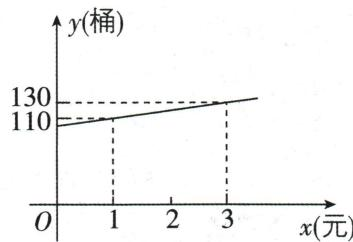

<!-- question-source:start -->
3 某药店新进一批桶装消毒液,每桶进价为 35 元,原计划以每桶 55 元的价格销售,现决定降价销售.已知这种消毒液销售量 y(桶)与每桶降价 x(元)(0<x<20)之间满足一次函数关系,

其图象如图所示.

(1) 求 $y$ 与 $x$ 之间的函数关系式;

(2)在这次降价活动中,该药店仅获利1760元.这种消毒液每桶实际售价为多少元?

<!-- question-source:end -->

![[Q00106524A1]]
