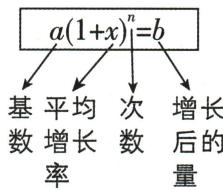

> [!success]- 必刷题
>
> > [!success] **【答案】** 10%
>
> > [!note]- **【解析】**
> > 设线上销售量占比的月平均增长率为 x. 根据题意, 得 $25\%(1+x)^{2}=30.25\%$ , 解得 $x_{1}=0.1=10\%$ , $x_{2}=-2.1$ (不合题意, 舍去), ∴ 线上销售量占比的月平均增长率为 10%. 故答案为 10%.
> >
> > 刷有所得 | 平均增长率问题的通法公式 —
> >
> > 
