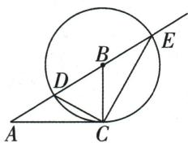

<!-- question-source:start -->
1 新考向传统文化 [中] 欧几里得的《几何原本》中记载了形如 $x^{2}-2bx+4c^{2}=0$ (b>2c>0) 的方程根的图形解法: 如图, 画 Rt $\triangle ABC$ , 使 $\angle ACB=90^{\circ}$ , AC=2c, AB=b, 以 B 为圆心, BC 长为半径画圆, 交射线 AB 于点 D, E, 则该方程较大的根是 ()

A. $CE$ 的长度 B. $CD$ 的长度 C. $DE$ 的长度 D. $AE$ 的长度
<!-- question-source:end -->

![[Q00106461A1]]
