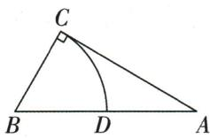
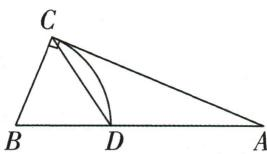

<!-- question-source:start -->
1[2025 浙江温州期中, 中]在欧几里得的《几何原本》中, 形如 $x^{2} + ax = b^{2} (a > 0, b > 0)$ 的方程的图解法是如图(1), 分别以 $\frac{a}{2}$ 和 $b$ 为直角边作 Rt $\triangle ABC$ , $\angle ACB = 90^{\circ}$ , 再在斜边上截取 $BD = \frac{a}{2}$ , 则 $AD$ 的长就是所求方程的正根. 若关于 $x$ 的一元二次方程 $x^{2} + 2mx = 36$ , 按照图(1)构造图(2), 在 Rt $\triangle ABC$ 中, $\angle ACB = 90^{\circ}$ , 连接 $CD$ , 若 $\frac{S_{\triangle BCD}}{S_{\triangle ACD}} = \frac{5}{8}$ , 则 $m$ 的值为 ( )

图(1)

图(2)

A. 8 B. 5 C. 2.5 D. $\frac{5}{4}$
<!-- question-source:end -->

![[Q00106526A1]]
