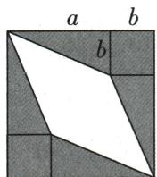
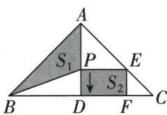

<!-- question-source:start -->
2[2025 江苏宿迁期末, 中]将 2 张长为 $a$ , 宽为 $b$ ( $a > b > 0$ ) 的矩形纸片沿对角线剪裁后, 和 2 张边长为 $b$ 的小正方形纸片按如图的方式拼成一个边长为 $(a + b)$ 的大正方形, 若图中阴影部分的面积与空白部分的面积之比为 $1:2$ , 则 $\frac{a}{b} =$ \_\_\_\_.

(第2题图)

(第3题图)
<!-- question-source:end -->

![[Q00106527A1]]
