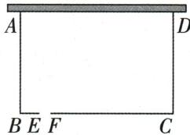

<!-- question-source:start -->
4[2024 山东东营调研, 中]如图, 老李想用长为 70 m 的栅栏, 再借助房屋的外墙 (外墙长为 35 m) 围成一个矩形羊圈 ABCD, 并在边 BC 上留一个 2 m 宽的门 (建在 EF 处, 另用其他材料).

(1) 当羊圈的长和宽分别为多少米时, 能围成一个面积为 $640 \, m^{2}$ 的羊圈?

(2)羊圈的面积能达到 $650 \, m^{2}$ 吗? 如果能, 请你给出设计方案; 如果不能, 请说明理由.

<!-- question-source:end -->

![[Q00106529A1]]
