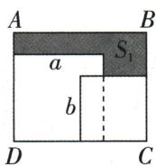
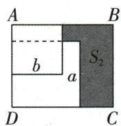
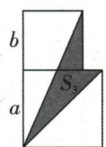

<!-- question-source:start -->
5 核心素养模型观念 [较难] 已知在长方形纸片 $AB-CD$ 中, $AB=6$ , $AD=5$ , 现将两个边长分别为 $a$ 和 $b$ 的正方形纸片按图(1)、图(2)两种方式放置 (图(1)、图(2)中两张正方形纸片中均有部分重叠), 长方形中未被这两张正方形纸片覆盖的部分用阴影表示, 设图(1)中阴影部分的面积为 $S_{1}$ , 图(2)中阴影部分的面积为 $S_{2}$ , 若 $S_{2}-S_{1}=3$ , 则 $b=$ \_\_\_\_ ; 在上述条件下, 在边长为 $a$ 的大正方形纸片的左上角摆放一个边长为 $b$ 的小正方形纸片, 如图(3), 若 $S_{1}=8$ , 则图(3)中阴影部分的面积 $S_{3}=$ \_\_\_\_.

图(1)

图(2)

图(3)

是个新“烤”鸭

电子错题本鸭
<!-- question-source:end -->

![[Q00107130A1]]
