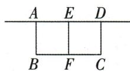

<!-- question-source:start -->
9[2024 上海浦东新区期中]如图是一个矩形花

圃的平面图,花圃由一堵旧墙(旧墙的长度足够长)和总长为28米的篱笆围成,中间

用篱笆分隔成两个小矩形. 设大矩形垂直于旧墙的一边长为 $x$ 米, 花圃总面积为 $y$ 平方米, 则 $y$ 关于 $x$ 的函数解析式为 \_\_\_\_. (用二次函数的一般形式表示)

② 刷易错 ▶ 小心有坑\~
<!-- question-source:end -->

![[Q00106566A1]]
