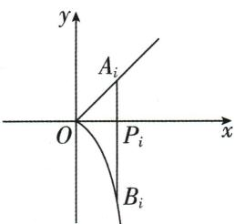
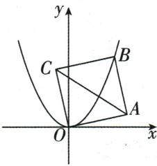

<!-- question-source:start -->
1[2025 山西吕梁期中, 中]如图, 分别过点 $P_{i}(i, 0) (i=1,2,\cdots,2\ 024)$ 作 x 轴的垂线, 交直线 y=x 于点 $A_{i}$ , 交抛物线 $y=-x^{2}$ 于点 $B_{i}$ , 则 $\frac{1}{A_{1}B_{1}}+\frac{1}{A_{2}B_{2}}+\cdots+\frac{1}{A_{2024}B_{2024}}$ 的值为 ( )
A. $\frac{2\ 024}{2\ 025}$ B. $\frac{2\ 023}{2\ 024}$ C. $\frac{1}{2\ 024\times2\ 025}$ D. $\frac{1}{2\ 023\times2\ 024}$

(第1题图)

(第3题图)
<!-- question-source:end -->

![[Q00106578A1]]
