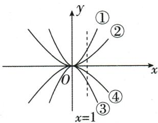
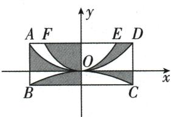

<!-- question-source:start -->
4[中]如图所示,四个二次函数的图象中,分别对应的解析式是① $y=ax^{2}$ ;② $y=bx^{2}$ ;③ $y=cx^{2}$ ;④ $y=dx^{2}$ ,则a,b,c,d的大小关系为\_\_\_\_.
(用“>”连接)

(第 4 题图)

(第5题图)
<!-- question-source:end -->

![[Q00106581A1]]
