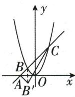
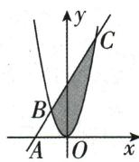

<!-- question-source:start -->
7 思想方法 分类讨论 [2024 湖南益阳期中, 较难] 在平面直角坐标系 $xOy$ 中, 直线 $l: y = a(x + 2) (a > 0)$ 与 $x$ 轴交于点 $A$ , 与抛物线 $E: y = ax^2$ 交于 $B$ , $C$ 两点 ( $B$ 在 $C$ 的左边).

(1) 求 A 点的坐标;

(2)如图(1)，若 B 点关于 x 轴的对称点为 $B'$ 点，当以点 A, $B'$ , C 为顶点的三角形是直角三角形时，求实数 a 的值；

(3) 定义: 将平面直角坐标系中横坐标与纵坐标均为整数的点叫做整点, 如 $(-2,1)$ , $(2,0)$ 均为整点. 如图(2), 直线 l 与抛物线 E 所围成的封闭图形(即阴影部分, 不包含边界)内的整点数恰好是 26 个, 求 a 的取值范围.

图(1)

图(2)
<!-- question-source:end -->

![[Q00107134A1]]
