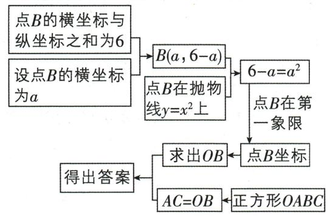
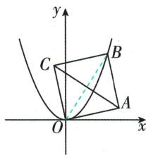

> [!success]- 必刷题
>
> > [!success] **【答案】** C
>
> > [!note]- **【解析】**
> > ∵ $y = x^{2}, 1 > 0$ , ∴ 该函数图象的对称轴为 y 轴, 开口向上, ∴ 当 x < 0 时, y 随 x 的增大而减小; 当 x > 0 时, y 随 x 的增大而增大. A 选项, 当 $x_{1} > x_{2}$ 时, $y_{1}$ 不一定大于 $y_{2}$ , 例如当 $x_{1} = 1$ 时, $y_{1} = 1$ , 当 $x_{2} = -2$ 时, $y_{2} = 4$ , 此时 $x_{1} > x_{2}$ , 但是 $y_{1} < y_{2}$ , 故选项 A 错误. B 选项, 当 $x_{1} < x_{2}$ 时, $y_{1}$ 不一定小于 $y_{2}$ , 例如当 $x_{1} = -2$ 时, $y_{1} = 4$ , 当 $x_{2} = 1$ 时, $y_{2} = 1$ , 此时 $x_{1} < x_{2}$ , 但是 $y_{1} > y_{2}$ , 故选项 B 错误. C 选项, ∵ $x_{1} x_{2} > x_{2}^{2}$ , ∴ ( $x_{1} - x_{2}$ ) · $x_{2} > 0$ , ∴ $x_{1} < x_{2} < 0$ 或 $x_{1} > x_{2} > 0$ . 当 $x_{1} < x_{2} < 0$ 时, $y_{1} > y_{2}$ ; 当 $x_{1} > x_{2} > 0$ 时, $y_{1} > y_{2}$ , ∴ 当 $x_{1} x_{2} > x_{2}^{2}$ 时, $y_{1} > y_{2}$ , 故选项 C 正确. D 选项, 当 $x_{1} x_{2} < x_{2}^{2}$ 时, $y_{1}$ 不一定小于 $y_{2}$ , 例如当 $x_{1} = -2$ 时, $y_{1} = 4$ , 当 $x_{2} = 1$ 时, $y_{2} = 1$ , 此时 $x_{1} x_{2} = -2 < x_{2}^{2} = 1$ , 但是 $y_{1} > y_{2}$ , 故选项 D 错误. 故选 C.
> >
> > 思路分析 | 抛物线与几何的综合
> >
> > 
> >
> > 思路分析
> > (2) 表示出 $AB'$ , $B'C$ , AC 的长, 利用勾股定理列方程并求解, 因为直角顶点不确定, 所以需分类讨论.
> >
> > 【解析】设点 B 的横坐标为 a. ∵ 点 B 的横坐标与纵坐标之和等于 6, ∴ 点 B 的纵坐标为 6-a. ∵ 点 B 在二次函数 $y = x^{2}$ 的第一象限的图象上, ∴ $6 - a = a^{2}$ , 解得 $a_{1} = -3$ (不
> >
> > 
> >
> > 合题意,舍去), $a_{2}=2,\therefore6-a=4,\therefore$ 点B的坐标为(2,4).如图,连接OB,则 $BO=\sqrt{2^{2}+4^{2}}=2\sqrt{5}.\because$ 四边形OABC是正方形, $\therefore AC=OB=2\sqrt{5}.$
> >
> > 故选 **C**.
