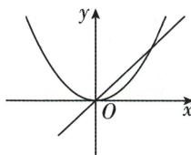

> [!success]- 必刷题
>
> > [!success] **【答案】** 1 (答案不唯一)
>
> > [!note]- **【解析】**
> > 由 $\left\{ \begin{array}{l} y = x, \\ y = x^2 \end{array} \right.$ 解得 $\left\{ \begin{array}{l} x = 0, \\ y = 0 \end{array} \right.$ 或 $\left\{ \begin{array}{l} x = 1, \\ y = 1, \end{array} \right.$ ∴ 函数 $y_1 = x$ 的图象与函数
> >
> > $y_{2}=x^{2}$ 的图象的交点为
> > (0,0) 和 (1,1)，如图.
> > ∵ 函数 $y_{1}=x(x<m)$ 的图象与函数 $y_{2}=x^{2}(x\geqslant m)$ 的
> >
> > 
> >
> > 图象组成图形 G, 对于任意实数 n, 过点 $P(0, n)$ 且与 x 轴平行的直线总与图形 G 有公共点, $\therefore 0 \leqslant m \leqslant 1$ , 故答案为 1 (答案不唯一).
> >
> > ## 刷素养·
