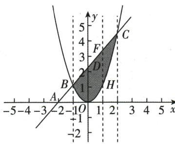

> [!success]- 必刷题
>
> > [!success] **【答案】** A
>
> > [!note]- **【解析】**
> > 【解】(1)令 $y=a(x+2)=0$ ，得 x=-2，则 A 点的坐标为 $(-2,0)$ .
> > (2)联立直线 $l: y = a(x + 2)$ 与抛物线 $E: y = ax^{2}$ 得 $\left\{\begin{aligned}y &= a(x+2),\\ y &= ax^{2},\end{aligned}\right.$ $\therefore x^{2}-x-2=0,\therefore x=-1$ 或 x=2, $\therefore B(-1,a),C(2,4a).$ $\because B$ 点关于 x 轴的对称点为 $B'$ 点, $\therefore B'(-1,-a),\therefore AB'^{2}=(-2+1)^{2}+(0+a)^{2}=a^{2}+1,AC^{2}=(2+2)^{2}+(4a-0)^{2}=16a^{2}+16,B'C^{2}=(2+1)^{2}+(4a+a)^{2}=25a^{2}+9.$ 若 $\angle CAB' = 90^{\circ}$ ，则 $AB'^{2} + AC^{2} = B'C^{2}$ ，即 $a^{2} + 1 + 16a^{2} + 16 = 25a^{2} + 9, \therefore a = 1$ （负值已舍去）；若 $\angle AB'C = 90^{\circ}$ ，则 $AB'^{2} + B'C^{2} = AC^{2}$ ，即 $a^{2} + 1 + 25a^{2} + 9 = 16a^{2} + 16, \therefore a = \frac{\sqrt{15}}{5}$ （负值已舍去）；
> > 若 $\angle ACB' = 90^{\circ}$ ，则 $AC^{2} + B'C^{2} = AB'^{2}$ ，即 $16a^{2} + 16 + 25a^{2} + 9 = a^{2} + 1$ ，此方程无实数解.
> > 综上，a=1 或 $\frac{\sqrt{15}}{5}$ .
> >
> > (3)如图,直线 l 与抛物线 E 所围成的封闭图形(即阴影部分,不包含边界)内的整点只能落在 y 轴和直线 x=1 上.
> >
> > 
> >
> > $\because D(0,2a),H(1,a),F(1,3a),\therefore OD=HF=2a.$ 整点数恰好是26个， $\therefore$ 落在y轴和直线x=1上的整点数应各为13个.由落在y轴上的整点有13个得 $13<2a\leqslant14$ ，即 $\frac{13}{2}<a\leqslant7.$ ①若 $\frac{13}{2}<a<7$ ，则 $\frac{13}{2}<y_{H}<7$ ，∴线段HF上的整点应该为 $(1,7),(1,8),\cdots,(1,19)$ ，∴ $19<3a\leqslant20,\therefore\frac{19}{3}<a\leqslant\frac{20}{3},\therefore\frac{13}{2}<a\leqslant\frac{20}{3};$ ②若a=7，
> > 则 $y_{H}=7,y_{F}=21$ ，∴线段HF上的整点正好有13个.综上， $\frac{13}{2}<a\leqslant\frac{20}{3}$ 或a=7.
> >
> > 22.1.3 二次函数 $y = a(x - h)^2 + k$ 的图象和性质
> >
> > 课时1 二次函数 $y = ax^{2} + k$ 的图象和性质
