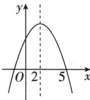

<!-- question-source:start -->
1[2025广西南宁期末]如图,二次函数 $y=-x^{2}+mx+n$ 的图象与 x 轴的一个交点坐标为(5,0),那么关于 x 的一元二次方程

$-x^{2}+mx+n=0$ 的解为
A. $x_{1}=5, x_{2}=1$ B. $x_{1}=5, x_{2}=-1$ C. $x_{1}=5, x_{2}=-5$ D. x=5
<!-- question-source:end -->

![[Q00107156A1]]
