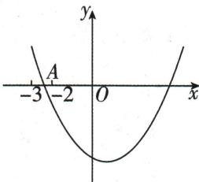

<!-- question-source:start -->
4 如图, 以点(1,-4)为顶点的二次函数 $y = ax^2 + bx + c$ 的图象与 $x$ 轴负半轴交于 $A$ 点, 则一元二次方程 $ax^2 + bx + c = 0$ 的正数解所

在的范围是 （ ）A. $2 <   x <   3$ B. $3 <   x <   4$ C. $4 <   x <   5$ D. $5 <   x <   6$
<!-- question-source:end -->

![[Q00107159A1]]
