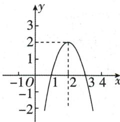
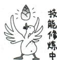

<!-- question-source:start -->
8 二次函数 $y = ax^{2} + bx + c (a \neq 0)$ 的图象如图所示, 根据图象解答下列问题:

(1) 写出关于 $x$ 的一元二次方程 $ax^2 + bx + c = 0$ 的两个根.

(2) 写出关于 $x$ 的不等式 $ax^2 + bx + c > 0$ 的解集.

(3) 写出关于 $x$ 的一元二次方程 $ax^2 + bx + c - 2 = 0$ 的根的情况.

<!-- question-source:end -->

![[Q00107163A1]]
