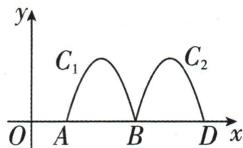

<!-- question-source:start -->
2[中]抛物线 $y=-2x^{2}+8x-6$ 与 x 轴交于点 A, B, 如图, 把抛物线在 x 轴及其上方的部分记作 $C_{1}$ , 将 $C_{1}$ 向右平移得 $C_{2}, C_{2}$ 与 x 轴交于点 B, D. 若直线 $y=x+n$ 与 $C_{1}, C_{2}$ 共有 3 个不同的交点, 则 n 的取值范围是 ( )

A. $-2 < n < \frac{1}{8}$ B. $-3 < n < -\frac{7}{4}$ C. $-3 < n < -2$ D. $-3 < n < -\frac{15}{8}$
<!-- question-source:end -->

![[Q00107165A1]]
