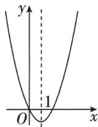

<!-- question-source:start -->
3[2025 浙江宁波期中, 中]二次函数 $y = x^{2} + bx$ 的图象如图, 对称轴为直线 x = 1. 若关于 x 的一元二次方程 $x^{2} + bx - t = 0 (b, t$ 为实数) 在 -1 < x < 4 的范围内有解, 则 t 的取值范围是 \_\_\_\_.

<!-- question-source:end -->

![[Q00107166A1]]
