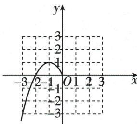

<!-- question-source:start -->
6 思想方法数形结合 [较难] 利用函数图象探究方程 $x(|x| - 2) = \frac{1}{2}$ 的实数根的个数.

(1) 设函数 $y = x(|x| - 2)$ ，则这个函数的图象与直线 $y = \frac{1}{2}$ 的交点的横坐标就是方程 $x(|x| - 2) = \frac{1}{2}$ 的实数根.

(2) 分类讨论: 当 $x \leqslant 0$ 时, $y = -x^{2} - 2x$ ;
当 x > 0 时, y = \_\_\_\_.

(3)如图,在给定的坐标系中,已经画出了当 $x\leqslant0$ 时的函数图象,请根据(2)中的解析式,通过描点、连线,画出当x>0时的函数图象.

(4)如图,在给定的坐标系中画直线 $y=\frac{1}{2}$ , 观察图象可知方程 $x(|x|-2)=\frac{1}{2}$ 的实数根有 \_\_\_\_ 个.

(5)深入探究:若关于x的方程 $2x(|x|-2)=m$ 有三个不相等的实数根,且这三个实数根的和为负数,则m的取值范围是\_\_\_\_.

建议用时 40 分钟 答案 D26
<!-- question-source:end -->

![[Q00107170A1]]
