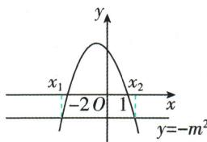

> [!success]- 必刷题
>
> > [!success] **【答案】** B
>
> > [!note]- **【解析】**
> > ∵ 二次函数 $y = -x^{2} + bx + c$ 的图象经过 $(-2,0)$ 与 $(1,0)$ 两点， $x_{1}, x_{2} (x_{1} < x_{2})$ 是关于 x 的一元二次方程 $-x^{2} + bx + c + m^{2} = 0$ 的两
> >
> > 根， $\therefore x_{1}, x_{2} (x_{1} < x_{2})$ 是二次函数 $y = -x^{2} + bx + c$ 的图象与直线 $y = -m^{2}$ 的交点的横坐标，如图所示，由图象可得， $x_{1} \leqslant -2 < 1 \leqslant x_{2}$ ，故选 B.
> >
> > 
