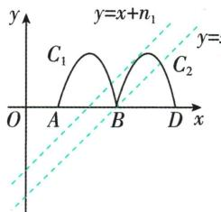

> [!success]- 必刷题
>
> > [!success] **【答案】** D
>
> > [!note]- **【解析】**
> > 令 $y = -2x^{2} + 8x - 6 = 0$ ，即 $x^{2} - 4x + 3 = 0$ ，解得 x = 1 或 3，则点 $A(1, 0)$ ， $B(3, 0)$ 。∵ 3 - 1 = 2，∴ 将 $C_{1}$ 向右平移 2 个单位长度得到 $C_{2}$ 。∵ $C_{1}$ 所在抛物线的解析式为 $y = -2(x - 2)^{2} + 2$ ，∴ $C_{2}$ 的解析式为 $y = -2(x - 4)^{2} + 2 (3 \leqslant x \leqslant 5)$ 。如图，当直线 $y = x + n_{1}$ 与 $C_{2}$ 只有一个公共点时，令 $x + n_{1} = -2(x - 4)^{2} + 2$ ，即方程
> >
> > $2x^{2}-15x+30+n_{1}=0$ 有两个相等的实数根， $\therefore \Delta = (-15)^{2} - 4 \times 2 \times (30 + n_{1}) = 0$ ，解得 $n_{1} =$
> >
> > $-\frac{15}{8}$ . 当直线 $y=x+$ $n_{2}$ 过点 $B(3,0)$ 时， $0=3+n_{2}$ ，解得 $n_{2}=$ -3,∴当 $-3<n<-\frac{15}{8}$
> >
> > $$
> > y = x + n _ {2}
> > $$
> >
> > 
> >
> > 时, 直线 $y = x + n$ 与 $C_{1}, C_{2}$ 共有 3 个不同的交点.
> >
> > 故选 **D**.
