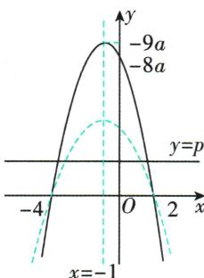

> [!success]- 必刷题
>
> > [!success] **【答案】** 3
>
> > [!note]- **【解析】**
> > ∵ 抛物线 $y=ax^{2}+bx+c(a<0)$ 的对
> >
> > 称轴为直线 x = -1, $\therefore -\frac{b}{2a}=-1$ , 解得 b=2a.
> > 又∵抛物线 $y=ax^{2}+bx+c$ (a<0) 与 x 轴的一个交点为 $(2,0)$ ，把 $(2,0)$ 代入 $y=ax^{2}+bx+c$ ，得 0=4a+4a+c，解得 c=-8a，
> >
> > 
> >
> > $\therefore y = ax^{2} + 2ax - 8a (a < 0)$ , 则函数的最大值为 $\frac{4a \cdot (-8a) - 4a^{2}}{4a} = -9a, \therefore$ 抛物线顶点坐标为 $(-1, -9a)$ . 令 $ax^{2} + 2ax - 8a = 0$ , 即 $x^{2} + 2x - 8 = 0$ , 解得 $x = -4$ 或 $x = 2, \therefore$ 当 $a < 0$ 时, 抛物线始终与 $x$ 轴交于 $(-4, 0), (2, 0)$ . 如图所示, 当 $ax^{2} + bx + c = p (p > 0)$ 有实数根时, $0 < y \leqslant -9a, -4 < x < 2$ , 其中 $x$ 为整数时, $x = -3, -2, -1, 0, 1, \therefore$ 一元二次方程 $ax^{2} + bx + c = p (p > 0)$ 的整数解有5个. 由抛物线的对称性可知 $x = -3$ 与 $x = 1$ 时的函数值相等, $x = -2$ 与 $x = 0$ 时的函数值相等, 当 $x = -1$ 时, 直线 $y = p$ 恰好过抛物线顶点, $\therefore p$ 的值有3个. 故答案为3.
