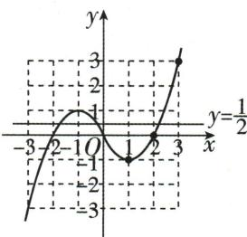
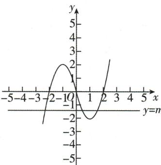

> [!success]- 必刷题
>
> > [!success] **【答案】** $x^{2}-2x$
>
> > [!note]- **【解析】**
> > 【解】(2)当x>0时, $y=x(|x|-2)=x(x-2)=x^{2}-2x$ ,故答案为 $x^{2}-2x$ .
> >
> > (3)如图(1)所示.
> > (4) 如图(1), 直线 $y=\frac{1}{2}$ 与 $y=x(|x|-2)$ 的图象有3个交点，
> > 故方程 $x(|x|-2)=\frac{1}{2}$ 的实数根有3个.
> > 故答案为3.
> >
> > 
> > 图(1)
> >
> > (5) 根据题意画出图象, 如图(2).
> > 直线 y = m 与函数 $y = 2x \left( |x| - 2 \right)$ 图象的交点的横坐标 $x_{1} < 0 < x_{2} < x_{3}$ ，且 $x_{2} + x_{3} = 2$ ， $x_{1} < -2, \therefore x_{1} + x_{2} + x_{3} < 0, \therefore -2 < m < 0, \therefore$ 关于 x 的方
> >
> > 
> > 图(2)
> >
> > 程 $2x(|x| - 2) = m$ 有三个不相等的实数根，且这三个实数根的和为负数，则 $m$ 的取值范围是 $-2 < m < 0$ ，故答案为 $-2 < m < 0$
