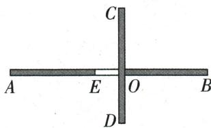

<!-- question-source:start -->
9[2024 四川自贡中考]九(1)班劳动实践基地内有一块面积足够大的平整空地,地上两段围墙 $AB \perp CD$ 于点O(如图),其中AB上的EO段围墙空缺.同学们测得AE=6.6m,OE=1.4m,OB=6m,OC=5m,OD=3m,班长买来可切断

的围栏 16 m, 准备利用已有围墙, 围出一块封闭的矩形菜地, 则该菜地最大面积是 \_\_\_\_ m².

<!-- question-source:end -->

![[Q00107211A1]]
