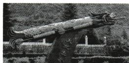
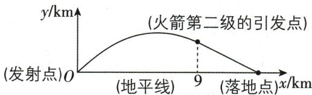

<!-- question-source:start -->
10[2024 湖北武汉中考]16 世纪中叶,我国发明了一种新式火箭“火龙出水”,它是二级火箭的始祖.火箭第一级运行路径形如抛物线,当火箭运行一定水平距离时,自动引发火箭第二级,火箭第二级沿直线运行.
某科技小组运用信息技术模拟火箭运行过程.如图,以发射点为原点,地平线为x轴,垂直于地面的直线为y轴,建立平面直角坐标系,分别得到抛物线 $y=ax^{2}+x$ 和直线 $y=-\frac{1}{2}x+b$ .其中,当火箭运行的水平距离为9 km时,自动引发火箭的第二级.
(1)若火箭第二级的引发点的高度为3.6 km,
①直接写出a,b的值;
②火箭在运行过程中,有两个位置的高度比火箭运行的最高点低1.35 km,求这两个位置之间的距离.
(2)直接写出a满足什么条件时,火箭落地点与发射点的水平距离超过15 km.

<!-- question-source:end -->

![[Q00107212A1]]
