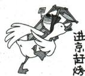

<!-- question-source:start -->
12[2024 天津中考]已知抛物线 $y = ax^2 + bx + c$ ( $a, b, c$ 为常数, $a > 0$ ) 的顶点为 $P$ , 且 $2a + b = 0$ , 对称轴与 $x$ 轴相交于点 $D$ , 点 $M(m, 1)$ 在抛物线上, $m > 1, O$ 为坐标原点.

(I) 当 $a = 1, c = -1$ 时, 求该抛物线顶点 $P$ 的坐标;

(II) 当 $OM = OP = \frac{\sqrt{13}}{2}$ 时, 求 $a$ 的值;

(III) 若 $N$ 是抛物线上的点, 且点 $N$ 在第四象限, $\angle MDN = 90^\circ$ , $DM = DN$ , 点 $E$ 在线段 $MN$ 上, 点 $F$ 在线段 $DN$ 上, $NE + NF = \sqrt{2}DM$ , 当 $DE + MF$ 取得最小值为 $\sqrt{15}$ 时, 求 $a$ 的值.

<!-- question-source:end -->

![[Q00107214A1]]
