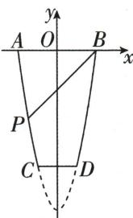
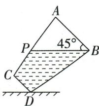

<!-- question-source:start -->
5[2025 河南平顶山质检]图(1)是玻璃水杯的截面图,其左右轮廓线 AC,BD 为某抛物线的一部分,杯口 AB=8 cm,杯底 CD=4 cm,且 AB//CD,杯深 12 cm. 如图(2),将盛有部分水的水杯倾斜 $45^{\circ}$ ,水面正好经过点 B(即 $\angle ABP=45^{\circ}$ ). 嘉淇在图(1)中建立了平面直角坐标系(抛物线的顶点在 y 轴上),对于下列结论,判断正确的是 ( )

结论Ⅰ:玻璃水杯轮廓线所在抛物线的解析式为 $y=x^{2}-16$ ;

结论Ⅱ:图(2)中,点 P 到杯口 AB 的距离为 5 cm.

图(1)

图(2)

A. I不对Ⅱ对 B. I对Ⅱ不对 C. I和Ⅱ都对 D. I和Ⅱ都不对
<!-- question-source:end -->

![[Q00107219A1]]
