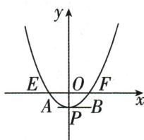

<!-- question-source:start -->
6 如图,一条抛物线(形状一定)与 x 轴相交于 E,

F 两点(点 E 在点 F 左侧), 其顶点 P 在线段 AB 上移动. 若点 A, B 的坐标分别为 $(-2, -3)$ , $(4, -3)$ , 点 E 的横坐标的最小值为 -5, 则点 F 的横坐标的最大值为

的横坐标的最大值为 （ ）
A.6 B.7 C.8 D.9
<!-- question-source:end -->

![[Q00107220A1]]
