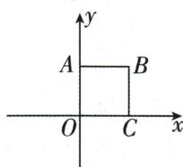

<!-- question-source:start -->
8 定义: 我们将图象的顶点的横坐标和纵坐标互为相反数的二次函数称为“互异二次函数”. 如图, 在正方形 OABC

中，点 $A(0,2)$ ，点 $C(2,0)$ ，则互异二次函数 $y = (x - m)^{2} - m$ 的图象与正方形OABC有交点时 $m$ 的最大值和最小值分别是 （）A.4,-1 B. $\frac{5 - \sqrt{17}}{2}, - 1$ C.4,0 D. $\frac{5 + \sqrt{17}}{2}, - 1$
<!-- question-source:end -->

![[Q00107222A1]]
