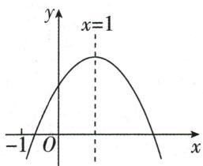
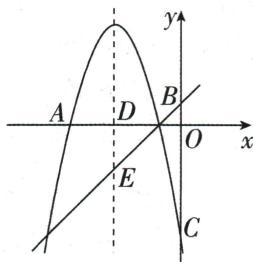

<!-- question-source:start -->
10[2025 吉林长春质检]已知二次函数 $y=ax^{2}+bx+c(a\neq0)$ 的图象如图,有下列 5 个结论: ①abc>0; ② $b^{2}>4ac$ ; ③ $2a+b=1$ ; ④ $4a+2b+c>0$ ; ⑤ $3a+c<0$ . 正确结论的序号为 \_\_\_\_.

(第 10 题图)

(第 12 题图)
<!-- question-source:end -->

![[Q00107224A1]]
