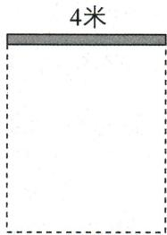
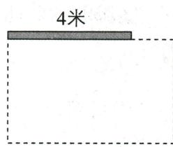

<!-- question-source:start -->
13[2025 浙江义乌期中]如图,小明的爸爸要用一堵长为4 m的墙和长为18 m的篱笆围一个小型养鸡场,要求:①墙和篱笆全部利用;②围成的养鸡场的面积最大.图(1)是小明的爸爸把墙体全部利用起来围成的养鸡场,图(2)是小明把墙体向外用篱笆延伸了一段,然后用剩余的篱笆围成的一个矩形养鸡场.(1)请计算小明爸爸围成的养鸡场的面积;(2)请计算小明围成的养鸡场比爸爸围成的

养鸡场面积大多少.

图(1)

图(2)
<!-- question-source:end -->

![[Q00107227A1]]
