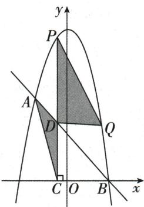
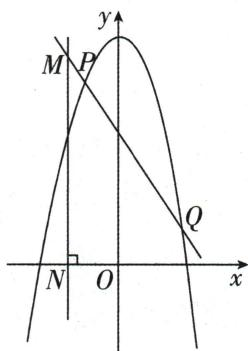

<!-- question-source:start -->
14[2024湖南中考]已知二次函数 $y = -x^{2} + c$ 的图象经过点 $A(-2,5)$ ，点 $P(x_{1},y_{1}), Q(x_{2},y_{2})$ 是此二次函数的图象上的两个动点. (1)求此二次函数的解析式；(2)如图(1)，此二次函数的图象与 $x$ 轴的正半轴交于点 $B$ ，点 $P$ 在直线 $AB$ 的上方，过点 $P$ 作 $PC \perp x$ 轴于点 $C$ ，交 $AB$ 于点 $D$ ，连接 $AC$ ， $DQ, PQ$ . 若 $x_{2} = x_{1} + 3$ ，求证： $\frac{S_{\triangle PDQ}}{S_{\triangle ADC}}$ 的值为定值；(3)如图(2)，点 $P$ 在第二象限， $x_{2} = -2x_{1}$ ，若点 $M$ 在直线 $PQ$ 上，且横坐标为 $x_{1} - 1$ ，过点 $M$ 作 $MN \perp x$ 轴于点 $N$ ，求线段 $MN$ 长度的最大值.

图(1)

图(2)
<!-- question-source:end -->

![[Q00107228A1]]
