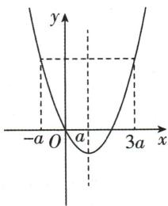
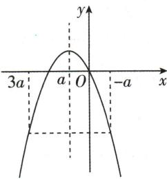

> [!success]- 必刷题
>
> > [!success] **【答案】** 详见解析
>
> > [!note]- **【解析】**
> > 【解】(1) 把 a=1 代入 $y=ax^{2}-2a^{2}x$ ，得 $y=x^{2}-2x=(x-1)^{2}-1$ ，∴ 抛物线的顶点坐标为 $(1,-1)$ .
> > (2) $\because y=ax^{2}-2a^{2}x,\therefore$ 抛物线的对称轴为直线 $x=-\frac{-2a^{2}}{2a}=a$ ，抛物线过原点. $\because M(x_{1},y_{1}),x_{1}=3a,\therefore M$ 关于直线 x=a 的对称点为 $(-a,y_{1})$ . 分两种情况: 当 a>0 时, 如图(1), 此时 3a<3, ∴ a<1, ∴ 0<a<1.
> >
> > ## 思路分析
> >
> > (1) 将 a=1 代入抛物线解析式, 即可求出抛物线的顶点坐标.
> >
> > (2) 因为不确定 a 与 0 的大小关系, 所以要分 a > 0 和 a < 0 两种情况讨论.
> >
> > 
> >
> > 
> > 图(1)
> > 图(2)
> >
> > 当 a<0 时, 如图(2), 此时 -a>4, 解得 a<-4.
> > 综上, a 的取值范围是 a<-4 或 0<a<1.
