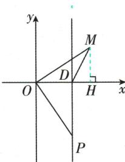
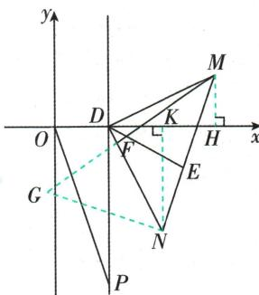

> [!success]- 必刷题
>
> > [!success] **【答案】** 详见解析
>
> > [!note]- **【解析】**
> > 【解】(Ⅰ)∵ $2a+b=0, a=1, \therefore b=-2a=-2$ .
> >
> > 又∵ c=-1, ∴ 该抛物线的解析式为 $y=x^{2}-2x-1$ . ∵ $y=x^{2}-2x-1=(x-1)^{2}-2$ , ∴ 该抛物线顶点 P 的坐标为 $(1,-2)$ .
> >
> > (Ⅱ)如图(1)，过点 $M(m,1)$ 作 $MH\perp x$ 轴，垂足为 H，则 $\angle MHO=90^{\circ}, HM=1, OH=m$ .
> >
> > 在 Rt $\triangle MOH$ 中， $HM^{2}+OH^{2}=OM^{2}, OM=\frac{\sqrt{13}}{2}, \therefore 1+m^{2}=\left(\frac{\sqrt{13}}{2}\right)^{2}$ ，解得 $m_{1}=\frac{3}{2}, m_{2}=-\frac{3}{2}$ （舍去），∴ 点 M 的坐标为 $\left(\frac{3}{2},1\right)$ . ∵ $2a+b=0$ ，即 $-\frac{b}{2a}=1$ ，∴ 抛物线 $y=ax^{2}-2ax+c$ 的对称轴为直线 x=1. ∵ 对称轴与 x 轴相交于点 D, ∴ OD=1, $\angle ODP=90^{\circ}$ . 在 Rt $\triangle OPD$ 中， $OD^{2}+PD^{2}=OP^{2}, OP=\frac{\sqrt{13}}{2}, \therefore 1+PD^{2}=\left(\frac{\sqrt{13}}{2}\right)^{2}$ ，解得 $PD=\frac{3}{2}$ （负值已舍去）. 由 a>0，得该抛物线顶点 P 的坐标为 $\left(1,-\frac{3}{2}\right)$ ，∴ 该抛物线的解析式为 $y=a(x-1)^{2}-\frac{3}{2}$ .
> >
> > ∵ 点 $M\left(\frac{3}{2},1\right)$ 在该抛物线上，∴ $1=a\left(\frac{3}{2}-1\right)^{2}-\frac{3}{2}$ , ∴ a=10.
> >
> > 
> >
> > 
> > 图(1)
> > 图(2)
> >
> > (Ⅲ)如图(2)，过点 $M(m,1)$ 作 $MH \perp x$ 轴，垂足为 H，则 $\angle MHO = 90^{\circ}, HM = 1, OH = m,$ $\therefore DH = OH - OD = m - 1, \therefore$ 在 Rt $\triangle DMH$ 中， $DM^2 = DH^2 + HM^2 = (m - 1)^2 + 1.$ 过点 $N$ 作 $NK \perp x$ 轴，垂足为 $K$ ，则 $\angle DKN = 90^\circ$ . 又 $\because \angle MDN = 90^\circ, \therefore$ 易得 $\angle DNK = \angle MDH.$ 又 $\because DN = DM, \therefore \triangle NDK \cong \triangle DMH, \therefore DK = MH = 1, NK = DH = m - 1, \therefore$ 点 $N$ 的坐标为 (2, 1-m). 在 Rt $\triangle DMN$ 中， $\angle DMN = \angle DNM = 45^\circ, MN^2 = DM^2 + DN^2 = 2DM^2$ ，即 $MN = \sqrt{2}DM.$ 根据题意， $NE + NF = \sqrt{2}DM, \therefore ME = NF.$ 在 $\triangle DMN$ 的外部，作 $\angle DNG = \angle DME = 45^\circ$ ，且 $NG = DM$ ，连接 $GF, GM$ ，易得 $\triangle GNF \cong \triangle DME, \therefore GF = DE, \therefore DE + MF = GF + MF \geqslant GM.$ 当满足条件的点 $F$ 落在线段 $GM$ 上时， $DE + MF$ 取得最小值，即 $GM = \sqrt{15}.$ $\because \angle MNG = \angle DNM + \angle DNG = 90^\circ, \therefore$ 在 Rt $\triangle GMN$ 中， $GM^2 = NG^2 + MN^2 = 3DM^2, \therefore (\sqrt{15})^2 = 3DM^2, \therefore DM^2 = 5, \therefore (m - 1)^2 + 1 = 5,$ 解得 $m_1 = 3, m_2 = -1$ （舍去）， $\therefore$ 点 $M$ 的坐标为 (3, 1)，点 $N$ 的坐标为 (2, -2). $\because$ 点 $M(3, 1), N(2, -2)$ 都在抛物线 $y = ax^2 - 2ax + c$ 上， $\therefore 1 = 9a - 6a + c, -2 = 4a - 4a + c, \therefore a = 1.$
> >
> > 关键点拨
> > 当 P 在 A 点时, 点 E 的横坐标最小; 当 P 在 B 点时, 点 F 的横坐标最大.
> >
> > ## 刷章测
