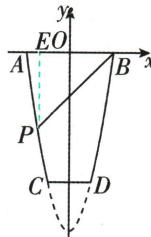

> [!success]- 必刷题
>
> > [!success] **【答案】** B
>
> > [!note]- **【解析】**
> > 如图, 过点 P 作 $PE \perp x$ 轴于 E. 由题得点 A (-4, 0), B (4, 0), C (-2, -12), D (2, -12). 设玻璃水杯轮廓线所在抛物线的解析式为 $y = a(x + 4)(x - 4)$ , 把点 C 的坐标代入得, -12 = a(-2 + 4)(-2 - 4), 解得 a = 1, $\therefore y = (x + 4)(x - 4) = x^{2} - 16$ , 故结论 I 正确. 设
> >
> > 点 $P(x, y)$ . $\because \angle ABP = 45^{\circ}$ , $\therefore \triangle PBE$ 是等腰直角三角形, $\therefore PE = BE = 4 - x = -y$ , $\therefore 4 - x = -(x^{2} - 16)$ , 解得 $x_{1} = -3, x_{2} = 4$ (舍去), $\therefore y = 9 - 16 = -7$ , $\therefore PE = 7$ , 即点 $P$ 到杯口 $AB$ 的距离为 $7 \mathrm{~cm}$ , 故结论 II 不正确.
> >
> > 
