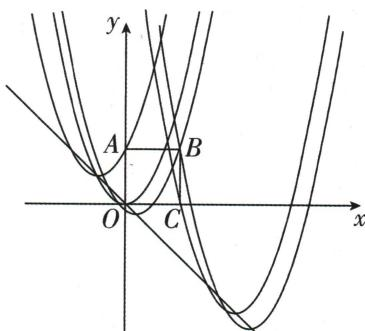

> [!success]- 必刷题
>
> > [!success] **【答案】** D
>
> > [!note]- **【解析】**
> > 如图,由题意可得,互异二次函数 $y=(x-m)^{2}-m$ 的图象的顶点 $(m,-m)$ 在直线 y=-x 上运动.
> >
> > 
> >
> > 在正方形 OABC 中, 点 A(0,2), 点 C(2,0), $\therefore B(2,2)$ . 从图象可以看出, 当函数图象从左上向右下运动时, 若抛物线与正方形有交点, 先经过点 A, 最后经过点 B, 且在运动的过程中, 两次经过点 A、点 O、点 B 和点 C, ∴ 只需算出当函数图象经过点 A 及点 B 时 m 的值, 即可求出 m 的最大值及最小值. 当互异二次函数 $y=(x-m)^{2}-m$ 的图象经过点 A(0,2) 时, m=2 或 m=-1; 当互异二次函数 $y=(x-m)^{2}-m$ 的图象经过点 B(2,2) 时, $m=\frac{5-\sqrt{17}}{2}$ 或 $m=\frac{5+\sqrt{17}}{2}$ , ∴ 互异二次函数 $y=(x-m)^{2}-m$ 的图象与正方形 OABC 有交点时 m 的最大值和最小值分别是 $\frac{5+\sqrt{17}}{2}$ , -1.
> >
> > 故选 **D**.
