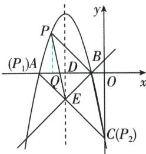

> [!success]- 必刷题
>
> > [!success] **【答案】** $(-4, 3)$ 或 $(0, -5)$ 或 $(-5, 0)$
>
> > [!note]- **【解析】**
> > ∵ $y=-x^{2}-6x-5=-(x+3)^{2}+4$ ，∴ 抛物线的对称轴为直线 x=-3，∴ $D(-3,0)$ 。∵ 抛物线的对称轴与经过点 B 的直线 $y=x+1$ 交于点 E，∴ 点
> >
> > 思路分析
> > (3) 先用含 $x_{1}$ 的代数式表示出 P, Q 的坐标, 求出直线 PQ 的解析式, 再代入 M 的横坐标得 M 的纵坐标, 从而得到关于 $x_{1}$ 的关系式, 最后用二次函数的性质求最值.
> >
> > B 的坐标为 $(-1,0)$ ，点 E 的坐标为 $(-3,-2)$ ，则 DE=BD=2，∴ $\angle ABE=\angle BED=45^{\circ}$ 。当 $\angle EBP=90^{\circ}$ 时， $\angle ABP=45^{\circ}$ 。过点 P 作
> >
> > $PQ \perp x$ 轴于点 $Q$ , 如图, 则 $\triangle BPQ$ 是等腰直角三角形, $\therefore PQ = BQ$ . 设点 $P$ 的坐标为 $(t, -t^2 - 6t - 5), \therefore -t^2 - 6t - 5 = -t - 1$ , 解得 $t_1 = -4, t_2 = -1$ (舍
> >
> > 
> >
> > 去), 此时点 $P$ 的坐标为 $(-4, 3)$ . 由点 $B(-1, 0), P(-4, 3)$ , 易得 $BP$ 所在直线的函数解析式为 $y = -x - 1$ . 将 $BP$ 所在直线平移至经过点 $E$ , 记此时直线与抛物线的交点分别为 $P_1, P_2$ , 则 $\angle BEP_1 = \angle BEP_2 = 90^\circ$ . 可设直线 $P_1P_2$ 的函数解析式为 $y = -x + m$ , 将 $E(-3, -2)$ 代入, 得 $-2 = 3 + m$ , 解得 $m = -5$ , $\therefore$ 直线 $P_1P_2$ 的函数解析式为 $y = -x - 5$ . 联立得 $\left\{ \begin{array}{l} y = -x - 5, \\ y = -x^2 - 6x - 5, \end{array} \right.$ 解得 $x = 0$ 或 $-5, \therefore P_1(-5, 0), P_2(0, -5)$ . 综上所述, 点 $P$ 的坐标为 $(-4, 3)$ 或 $(0, -5)$ 或 $(-5, 0)$ . 故答案为 $(-4, 3)$ 或 $(0, -5)$ 或 $(-5, 0)$ .
