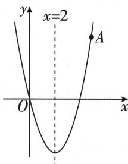

<!-- question-source:start -->
1[中]如图,已知抛物线过点 $O(0,0)$ , $A(5,5)$ , 其对称轴为直线 x=2.

(1) 求该抛物线的解析式.

(2) 若点 B 是抛物线对称轴上的一点, 且点 B 在第一象限.

①当 $\triangle OAB$ 的面积为15时,求点B的坐标;

②在①的条件下,P 是抛物线上的动点,当 PA-PB 取得最大值时,求点 P 的坐标.

<!-- question-source:end -->

![[Q00107150A1]]
