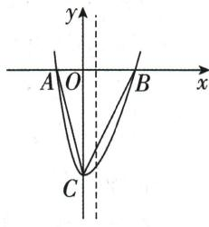

<!-- question-source:start -->
2[2024 山东济宁期中, 中]如图, 抛物线 $y = x^{2} + bx + c$ 与 x 轴交于 A, B 两点, 与 y 轴交于点 C, OA = 2, OC = 8, 连接 AC 和 BC.

(1) 求抛物线的解析式.

(2) 点 D 在抛物线的对称轴上, 当 $\triangle ACD$ 的周长最小时, 求点 D 的坐标.

<!-- question-source:end -->

![[Q00107151A1]]
