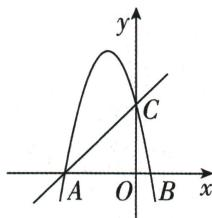

<!-- question-source:start -->
3[2024 山西晋中期中, 中]如图, 在平面直角坐标系中, 抛物线 $y = -x^{2} - 4x + c$ 与 x 轴交于点 A, B (点 A 在点 B 的左侧), 与 y 轴交于点 C, 且点 C 的坐标为 $(0, 5)$ .

(1) 求点 $A$ 的坐标;

(2) 若点 P 是第二象限内抛物线上一动点, 求点 P 到直线 AC 距离的最大值.

<!-- question-source:end -->

![[Q00107152A1]]
