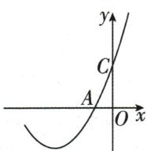
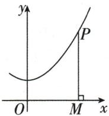
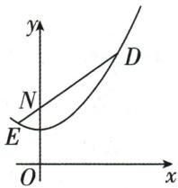

<!-- question-source:start -->
4[2025 湖北武汉质检,较难]如图(1),已知抛物线 $C_{1}:y=\frac{1}{4}x^{2}+bx+c$ 经过 y 轴正半轴上一点 $C(0,2)$ 和 x 轴负半轴上一点 A,且 $\frac{OC}{OA}=2$ .

(1)求抛物线 $C_1$ 的解析式.

(2) 将抛物线 $C_1$ 平移至其顶点与 $B(0,1)$ 重合得到抛物线 $C_2$ , 如图 (2) 所示, 设抛物线 $C_2$ 上有任意一点 $P$ , 过 $P$ 作 $PM \perp x$ 轴于点 $M$ , 则 $y$ 轴正半轴上是否存在一定点 $N$ , 使得线段 $PM = PN$ 恒成立? 若存在, 请求出 $N$ 点坐标; 若不存在, 则说明理由.

(3)在(2)的基础上,设过点N的直线l分别交抛物线 $C_{2}$ 于D,E两点(点D在点E右侧),如图(3)所示,请求出 $DN+3EN$ 的最小值.

图(1)

图(2)

图(3)
<!-- question-source:end -->

![[Q00107153A1]]
