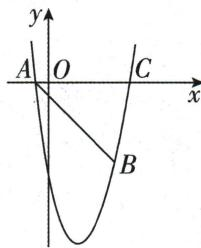

<!-- question-source:start -->
5[2024 河南洛阳期中, 中]如图, 抛物线 $y = ax^{2} + bx + c (a, b, c$ 为常数, $a \neq 0$ 经过点 A(-1, 0), B(5, -6), C(6, 0).

(1) 求抛物线的解析式.

(2)如图,连接AB,点P在直线AB下方的抛物线上,求出 $\triangle ABP$ 的面积最大时点P的坐标.

<!-- question-source:end -->

![[Q00107154A1]]
