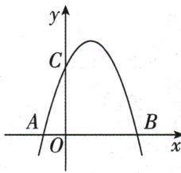

<!-- question-source:start -->
6[2024 湖北荆门期中,较难]如图,已知抛物线 $y=-x^{2}+2x+3$ 与 y 轴交于点 C,与 x 轴交于 A,B 两点(点 A 在点 B 左边).

(1)请直接写出A,B,C三点的坐标.

(2) 若点 P 是第一象限内抛物线上一点, 求 $\triangle PBC$ 面积最大时点 P 的坐标.

<!-- question-source:end -->

![[Q00107155A1]]
