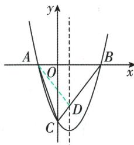

> [!success]- 必刷题
>
> > [!success] **【答案】** 详见解析
>
> > [!note]- **【解析】**
> > 【解】(1)∵OA=2,OC=8,∴A(-2,0),C(0,-8).将A(-2,0),C(0,-8)代入 $y=x^{2}+bx+c$ ,
> > 得 $\left\{\begin{aligned}&4-2b+c=0,\\ &c=-8,\end{aligned}\right.$ 解得 $\left\{\begin{aligned}&b=-2,\\ &c=-8,\end{aligned}\right.$ ∴抛物线的解析式为 $y=x^{2}-2x-8$ .
> >
> > (2)由 $y=x^{2}-2x-8$ 可知，对称轴为直线 x=1 。由抛物线的对称性可知，点 A 与点 B 关于对称轴对称。如图，设 BC 交对称轴于点 D ，连接 AD ，则 AD =
> >
> > 
> >
> > BD. 由两点之间线段最短可知, 此时 $AD + CD$ 最小, 而 AC 的长度是定值, 故此时 $\triangle ACD$ 的周长取得最小值. 由 $y = x^{2} - 2x - 8$ 可知, 点 B 的坐标为 (4,0). 设直线 BC 的解析式为 y = kx - 8, 将点 B(4,0) 代入, 得 k = 2, ∴ 直线 BC 的解析式为 y = 2x - 8, 当 x = 1 时, y = -6, ∴ 点 D 的坐标为 (1, -6).
> >
> > 大招解读 | 代数法求线段最值
> > 二次函数图象中求平行于坐标轴的线段最值问题时,常用代数法:设出动点坐标,利用坐标表示出线段长度,构造二次函数,利用二次函数的性质求最值.
