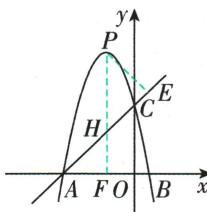

> [!success]- 必刷题
>
> > [!success] **【答案】** 详见解析
>
> > [!note]- **【解析】**
> > 【解】(1)∵点 $C(0,5)$ 在抛物线 $y=-x^{2}-4x+c$ 上，∴c=5，∴ $y=-x^{2}-4x+5$ ，令y=0，得 $0=-x^{2}-4x+5$ ，解得x=1或-5，∴点A的坐标为 $(-5,0)$ .
> >
> > (2)由(1)知, $B(1,0)$ .过P作 $PE\perp AC$ 于点E,过点P作 $PF\perp x$ 轴交AC于点H,如图.∵ $A(-5,0)$ , $C(0,5)$ ,∴OA=OC,∴ $\triangle AOC$ 是等腰直角三角形,
> >
> > 
> >
> > $\therefore \angle CAO = 45^{\circ}.\because PF\perp x$ 轴， $\therefore \angle AHF = 45^{\circ} =$ $\angle PHE,\therefore \triangle PHE$ 是等腰直角三角形， $\therefore PE =$ $\frac{PH}{\sqrt{2}},\therefore$ 当 $PH$ 取最大值时， $PE$ 取最大值.设直线 $AC$ 的解析式为 $y = kx + 5$ ，将 $A(-5,0)$ 代入得 $0 = -5k + 5,\therefore k = 1,\therefore$ 直线 $AC$ 的解析式为 $y = x + 5.$ 设 $P(m, - m^2 -4m + 5)(-5 <   m <   0)$ ，则 $H(m,m + 5),\therefore PH = (-m^2 -4m + 5) - (m + 5) =$ $-\left(m + \frac{5}{2}\right)^2 +\frac{25}{4}.\because a = -1 <   0,\therefore$ 当 $m = -\frac{5}{2}$ 时，
> >
> > $PH$ 取得最大值, 为 $\frac{25}{4}$ , $\therefore PE = \frac{25}{4\sqrt{2}} = \frac{25\sqrt{2}}{8}$ , $\therefore$ 点 $P$ 到直线 $AC$ 距离的最大值为 $\frac{25\sqrt{2}}{8}$ .
