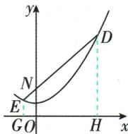
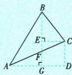
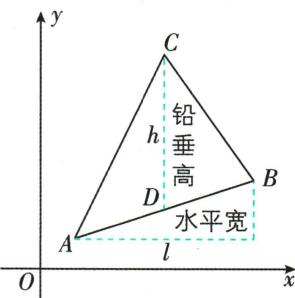

> [!success]- 必刷题
>
> > [!success] **【答案】** 详见解析
>
> > [!note]- **【解析】**
> > 【解】(1)∵ $C(0,2)$ , $\frac{OC}{OA}=2$ , 且点 A 位于 x 轴负半轴上, ∴ OC=2, OA=1, ∴ $A(-1,0)$ . 把 $A(-1,0)$ , $C(0,2)$ 代入 $y=\frac{1}{4}x^{2}+bx+c$ 得, $\left\{\begin{aligned}\frac{1}{4}-b+c=0,\\c=2,\end{aligned}\right.$ 解得 $\left\{\begin{aligned}b&=\frac{9}{4},\\ c&=2,\end{aligned}\right.$ ∴ 抛物线 $C_{1}$ 的解析式为 $y=\frac{1}{4}x^{2}+\frac{9}{4}x+2$ .
> >
> > (2)存在. 假设 $y$ 轴正半轴上存在一定点 $N$ , 使得 $PM = PN$ 恒成立. $\because$ 将抛物线 $C_1$ 平移至其顶点与 $B(0,1)$ 重合得到抛物线 $C_2$ , $\therefore$ 抛物线 $C_2$ 的函数解析式为 $y = \frac{1}{4} x^2 + 1$ . 设 $P(p, \frac{1}{4} p^2 + 1), N(0, n)$ . $\because PM \perp x$ 轴, $\therefore PM = \frac{1}{4} p^2 + 1, PN^2 = p^2 + \left(\frac{1}{4} p^2 + 1 - n\right)^2$ , 当 $PM = PN$ 时, $PM^2 = PN^2$ , $\therefore \left(\frac{1}{4} p^2 + 1\right)^2 = p^2 + \left(\frac{1}{4} p^2 + 1 - n\right)^2$ , 整理得 $\left(1 - \frac{n}{2}\right) p^2 - 2n + n^2 = 0$ . $\because y$ 轴正半轴上存在一定点 $N$ , 使得线段 $PM = PN$ 恒成立, $\therefore 1 - \frac{n}{2} = 0, \therefore n = 2, \therefore N(0, 2)$ . (3)如图, 作 $EG \perp x$ 轴于 $G$ , 作 $DH \perp x$ 轴于 $H$ . 设 $E(e, \frac{1}{4} e^2 + 1), D(d, \frac{1}{4} d^2 + 1)$ . 由 (2) 知,
> >
> > $EG = EN, DN = DH, \therefore DN + 3EN = \frac{1}{4} d^{2} + 1 + \frac{3}{4} e^{2} + 3 = \frac{1}{4} d^{2} + \frac{3}{4} e^{2} + 4.$ 设直线 $l$ 的解
> >
> > 
> >
> > 析式为 $y = kx + m$ ，把点 $E$ 、点 $D$ 的坐标代入得， $\left\{ \begin{array}{l}ek + m = \frac{1}{4} e^2 +1,\\ dk + m = \frac{1}{4} d^2 +1, \end{array} \right.$ 解得 $\left\{ \begin{array}{l}k = \frac{1}{4} (d + e),\\ m = 1 - \frac{1}{4} de, \end{array} \right.$ $\therefore y = \frac{1}{4} (d + e)x + 1 - \frac{1}{4} de.\because N(0,2)$ 在直线 $l$ 上， $\therefore 1 - \frac{1}{4} de = 2,\therefore de = -4,\therefore d = \frac{-4}{e},\therefore DN+$ $3EN = \frac{4}{e^2} +\frac{3}{4} e^2 +4 = \left(\frac{2}{e} -\frac{\sqrt{3}e}{2}\right)^2 +2\sqrt{3} +4.$
> >
> > 结论证明
> > 证明:如图, $S_{\triangle ABC} = S_{\triangle ABF} + S_{\triangle BCF}$ $=\frac{1}{2}BF\cdot AG+$ $\frac{1}{2}BF\cdot EC$ $=\frac{1}{2}BF\cdot (AG+EC)$ $=\frac{1}{2}BF\cdot (AG+GD)$ $=\frac{1}{2}BF\cdot AD.$
> >
> > 
> >
> > (2) 先求出直线 BC 的解析式, 易知 PD 取最大值时, $\triangle BCP$ 面积最大, 利用坐标将 PD 的长表示出来, 根据二次函数的最值就可以求出点 P 的坐标.
> >
> > $\because \left(\frac{2}{e} -\frac{\sqrt{3}e}{2}\right)^2\geqslant 0,\therefore DN + 3EN$ 的最小值是 $2\sqrt{3} +4.$
> >
> > 大招解读 | 铅锤法巧求面积最值
> > 铅锤法是一种求三角形面积的特殊方法,主要解决的是斜三角形面积问题.具体公式为三角形面积等于水平宽和铅垂高乘积的一半.三角形的水平宽指的是两个顶点之间的水平距离,而铅垂高是指从一个顶点到对边的铅垂高度.
> >
> > 
> >
> > $$
> > S _ {\triangle A B C} = \frac {1}{2} l \cdot h
> > $$
