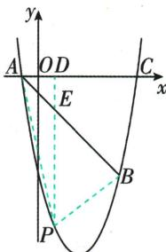

> [!success]- 必刷题
>
> > [!success] **【答案】** 详见解析
>
> > [!note]- **【解析】**
> > 【解】(1) 设 $y = a(x + 1)(x - 6) (a \neq 0)$ . 把 B(5, -6) 代入, 得 $a(5 + 1)(5 - 6) = -6$ , 解得 a = 1, $\therefore y = (x + 1)(x - 6) = x^{2} - 5x - 6$ .
> >
> > (2)如图,连接AP,BP,过点P作 $PD\perp x$ 轴于点D,交AB于点E.由A(-1,0),B(5,-6),易得直线AB的解析式为y=-x-1.设 $P(m,m^{2}-5m-6)(-1<m<5)$ ,则 $E(m,-m-1),\therefore PE=(-m-$
> >
> > 
> >
> > 1) $-\left(m^{2}-5m-6\right)=-m^{2}+4m+5,\therefore S_{\triangle ABP}=\frac{1}{2}PE\cdot\left(x_{B}-x_{A}\right)=\frac{1}{2}\left(-m^{2}+4m+5\right)\times6=-3(m-2)^{2}+27,\therefore$ 当m=2时, $S_{\triangle ABP}$ 最大,此时 $P(2,-12)$ .
