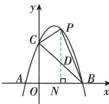

> [!success]- 必刷题
>
> > [!success] **【答案】** 详见解析
>
> > [!note]- **【解析】**
> > 【解】(1) $A(-1,0)$ , $B(3,0)$ , $C(0,3)$ . 当 x=0 时, $y=3$ , $\therefore C(0,3)$ . 当 y=0 时, $-x^{2}+2x+3=0$ , 解得 $x_{1}=3$ , $x_{2}=-1$ , $\therefore A(-1,0)$ , $B(3,0)$ .
> >
> > (2) 如图, 过点 P 作 $PN \perp x$ 轴于点 N, 交 BC 于点 D, 则 $S_{\triangle BCP} = \frac{1}{2} PD \cdot OB$ . $\because B(3, 0), \therefore OB = 3, \therefore S_{\triangle BCP} = \frac{1}{2} PD \cdot OB =$
> >
> > 
> >
> > $\frac{3}{2} PD.$ 设直线 $BC$ 的解析式为 $y = kx + b$ ，把 $B(3,0),C(0,3)$ 代入，得 $\left\{ \begin{array}{l}0 = 3k + b,\\ 3 = b, \end{array} \right.$ 解得 $\left\{ \begin{array}{l}k = -1,\\ b = 3, \end{array} \right.$ ∴直线 $BC$ 的解析式为 $y = -x + 3.$ 设 $P(m,$ $-m^2 +2m + 3)(0 <   m <   3)$ ，则 $D(m, - m + 3)$
> >
> > $\therefore PD = -m^2 + 2m + 3 - (-m + 3) = -m^2 + 3m = -\left(m - \frac{3}{2}\right)^2 + \frac{9}{4}, \therefore$ 当 $m = \frac{3}{2}$ 时, $PD$ 取最大值, 即 $\triangle BCP$ 的面积最大, $\therefore P\left(\frac{3}{2}, \frac{15}{4}\right)$ .
> >
> > ## 22.2 二次函数与一元二次方程
