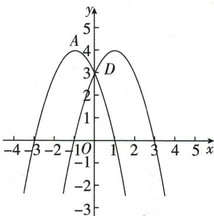

<!-- question-source:start -->
1[较难]如图,已知抛物线 $c_{1}$ 的顶点为A(-1,4),与y轴的交点为D(0,3).

(1)请直接写出 $c_{1}$ 的解析式;

(2) 若直线 $l_{1}: y = x + m$ 与 $c_{1}$ 有唯一的交点, 求 m 的值;

(3)若抛物线 $c_{1}$ 关于 y 轴对称的抛物线记作 $c_{2}$ ，平行于 x 轴的直线 y=n 记作 $l_{2}$ 。试结合图形回答：当 n 为何值时， $l_{2}$ 与 $c_{1}$ 和 $c_{2}$ 共有：①两个交点？②三个交点？③四个交点？

<!-- question-source:end -->

![[Q00107171A1]]
